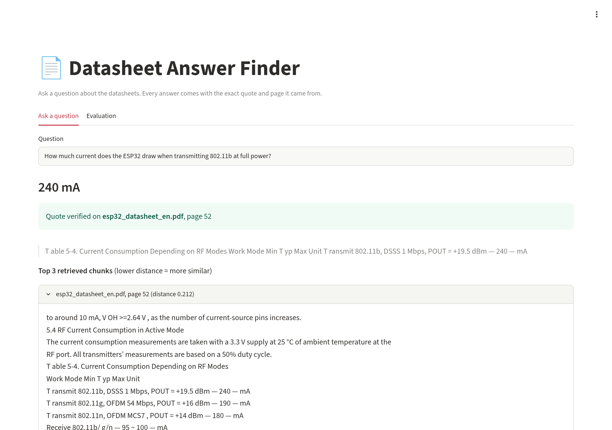
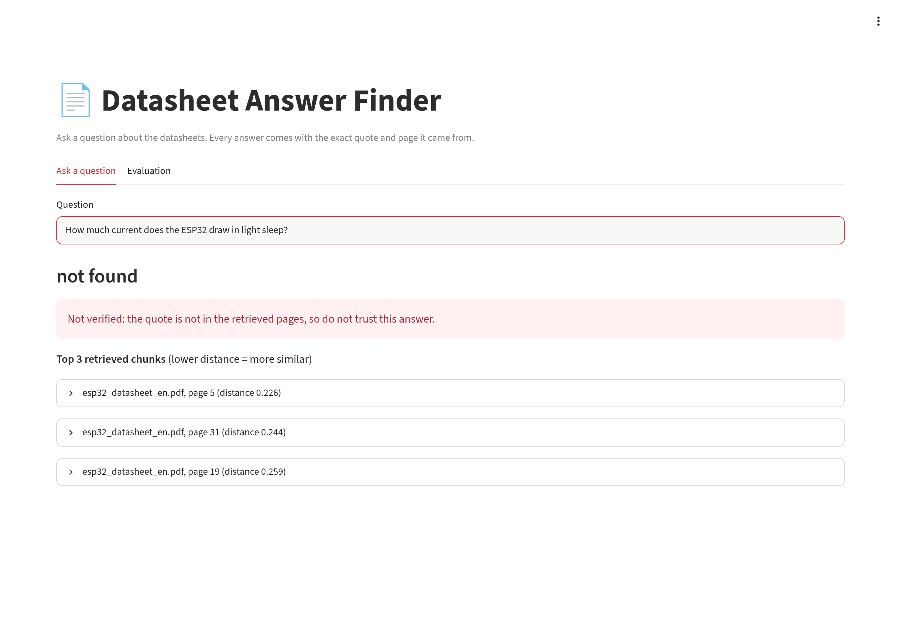
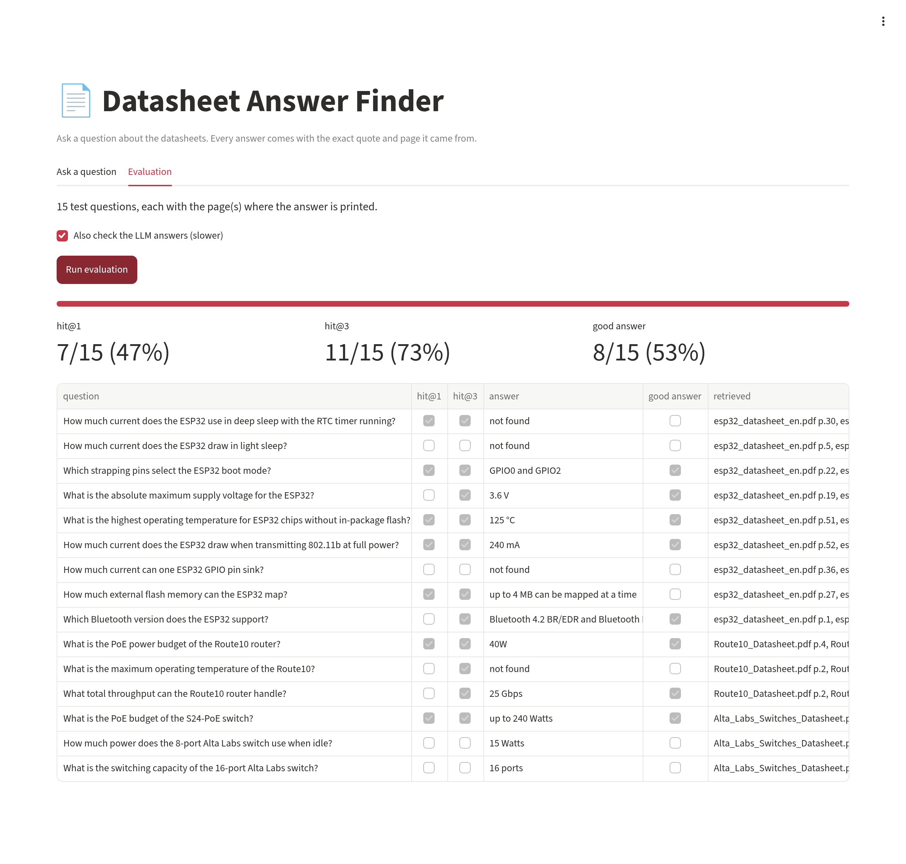

# Datasheet Answer Finder

Ask a plain question about a hardware datasheet (ESP32, a router and network switches) and get an answer with the exact page excerpt it came from, plus a score showing how often it finds the right page on a small question set.



| When the answer is not in the retrieved text | Evaluation on 15 test questions |
|---|---|
|  |  |

## Why I built this

I wanted hands-on practice with **Python**, so I built a small, complete tool with it in about an hour.

## How to run it

```bash
git clone https://github.com/kchimbodza/datasheet-answer-finder.git
cd datasheet-answer-finder
python -m venv .venv && source .venv/bin/activate
pip install -r requirements.txt

# Needs Ollama running locally with these two models:
ollama pull nomic-embed-text   # makes the embeddings
ollama pull llama3.2           # writes the answers

# Put the datasheet PDFs in data/ (they are not in this repo, see below)
python ingest.py               # splits pages into chunks, embeds them, stores them in chroma_db/
streamlit run app.py           # web UI: ask questions and run the evaluation
python ask.py "How much current does the ESP32 draw when transmitting 802.11b at full power?"
python evaluate.py             # retrieval score on the 15 test questions
python evaluate.py --answers   # also scores the LLM answers (slower)
python -m pytest               # tests for the excerpt check
```

Example output:

```
Answer: 240 mA
Quote:  "T able 5-4. Current Consumption Depending on RF Modes
Work Mode Min T yp Max Unit
T ransmit 802.11b, DSSS 1 Mbps, POUT = +19.5 dBm — 240 — mA"
Verified: quote found on esp32_datasheet_en.pdf page 52
```

### Datasheets used

The PDFs are not committed because they belong to their manufacturers. Download them into `data/`:

- `esp32_datasheet_en.pdf`: ESP32 Series Datasheet v5.3 (78 pages), from
  https://www.espressif.com/documentation/esp32_datasheet_en.pdf
- `Route10_Datasheet.pdf` (5 pages) and `Alta_Labs_Switches_Datasheet.pdf` (8 pages), from
  https://www.alta.inc

## How it works

- `ingest.py` reads each PDF page with pypdf and splits it into chunks of about 800 characters
  (whole lines only). Each chunk keeps its file name and page number. The file name is also put in
  front of the chunk text before embedding, so a spec table that never names the product is still
  linked to it. `nomic-embed-text` (through Ollama) turns each chunk into a vector, and the
  vectors are stored in a local Chroma collection.
- `search.py` embeds the question the same way and asks Chroma for the 3 nearest chunks
  (cosine distance).
- `ask.py` sends those chunks to `llama3.2` and requires a JSON reply with an answer and a
  word-for-word quote. It then checks that the quote really appears in one of the retrieved
  chunks (ignoring case and spacing). If it doesn't, the answer is marked **NOT VERIFIED**.
- `app.py` is a small Streamlit page with two tabs: one to ask a question (answer, verified
  quote, retrieved chunks) and one to run the evaluation and show the scores per question.
- `evaluate.py` runs the 15 questions in `questions.json`. Each has the page(s) where the answer
  is printed and a short expected answer. It reports how often a chunk from a right page is the
  top result (hit@1) or in the top 3 (hit@3). With `--answers` it also counts answers that
  contain the expected text **and** pass the quote check.

### Results (15 questions, measured on my machine)

| Measure | One chunk per page | ~800-character chunks (current) |
|---|---|---|
| Right page ranked 1st (hit@1) | 3/15 (20%) | 7/15 (47%) |
| Right page in top 3 (hit@3) | 6/15 (40%) | 11/15 (73%) |
| Answer correct **and** quote verified | 5/15 (33%) | 8/15 (53%) |

With whole pages, short prose pages (overview, feature lists) kept beating the dense spec
tables that hold the actual numbers. Smaller chunks fixed much of that.

### What I learned from the failures

- **The quote check proves a quote exists, not that it answers the question.** Asked for the
  idle power of the 8-port switch, the model answered "15 Watts" with a real, verified quote,
  but it came from the 24-port switch's spec page. Splitting the page had cut the table rows away
  from the header that says which switch they belong to.
- **A page-level hit is not always enough.** For the ESP32 deep-sleep question, a chunk from the
  right page (30) came first, but it was the prose part of the page, not the table row with
  "10 µA", so the model correctly said "not found".
- A verified quote can still be a non-answer. Asked for the Route10's retail price (not in the
  datasheet), the model answered "Disruptively priced" with a real quote from page 2
  ([screenshot](docs/ask-quote-but-no-answer.png)).
- One ESP32 page (69, a large pin table) is longer than the embedding model's 2048-token limit,
  so the end of it is cut off before embedding.
- pypdf reads the ESP32 PDF's minus sign as "⚶", so `ingest.py` replaces it with "-".

## Built with

Python, Ollama, Chroma

Built with help from an AI coding assistant (Claude Code). I planned, reviewed and tested every part.

## Author

**Kudzayi Chimbodza** · [GitHub @kchimbodza](https://github.com/kchimbodza)
