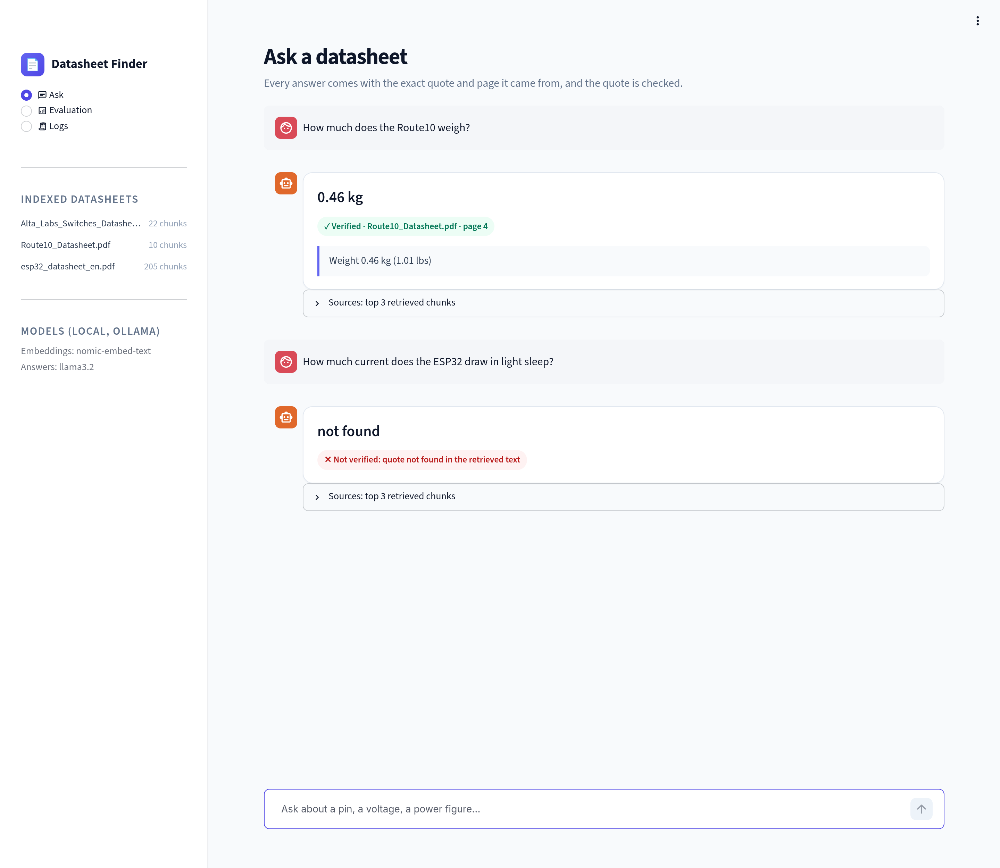
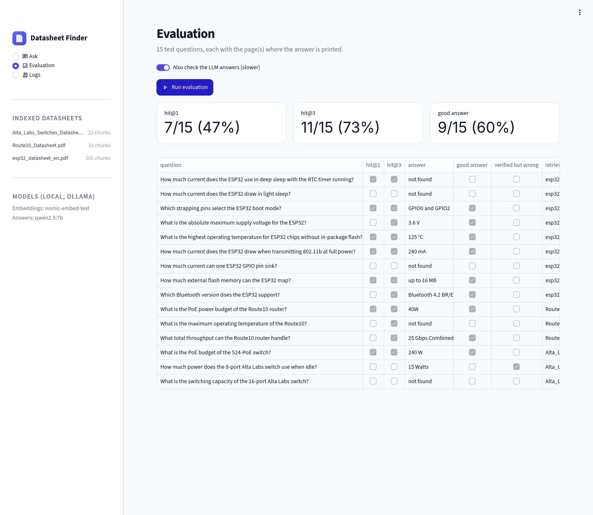
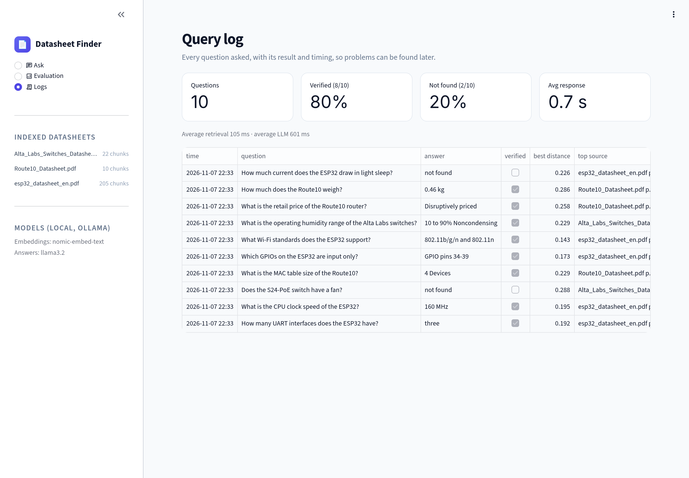

# Datasheet Answer Finder

Ask a plain question about a hardware datasheet and get an answer **with the exact quote and page it came from**. Every quote is checked, every question is logged, and the system is scored on a 15-question test set.


<sub>26-second demo · [full-quality MP4](docs/demo.mp4)</sub>

## At a glance

| | |
|---|---|
| **What it does** | Answers questions about long hardware datasheets (ESP32, a router, network switches) and shows the exact quote and page number for each answer |
| **Skills shown** | RAG (retrieval-augmented generation), vector search, embeddings, LLM evaluation, LLM observability |
| **Tech** | Python, Ollama (local LLMs), Chroma (vector database), Streamlit (web UI) |
| **Runs** | Fully on a laptop. No cloud services or API keys |

## Key results

- **Better retrieval through measurement:** splitting pages into smaller chunks raised how often the right page is found (top 3 results) from **40% to 73%**.
- **Compared 4 local LLMs on the same test set:** the best, `qwen2.5:7b` (now the default), gave correct, verified answers **60%** of the time, compared with 47% for the starting model.
- **Logging exposed a blind spot:** "quote verified" does not mean "answer correct". The query log showed real quotes attached to wrong answers, so I added a "verified but wrong" score.

## Architecture

<p align="center"></p>

1. **Index once:** every PDF page is cut into ~800-character chunks, embedded and stored in Chroma.
2. **Retrieve:** a question finds its 3 closest chunks.
3. **Answer:** a local LLM must answer from those chunks only, with a word-for-word quote, or say "not found".
4. **Verify:** the quote is searched for in the chunks. Found → answer shown with file and page. Not found → marked not verified.

**Why this architecture**

| Choice | Why |
|---|---|
| Local models (Ollama) | No API keys or cloud; datasheets stay on the laptop; free to run the test set many times. |
| Chroma | A vector database that runs inside the app, with no server to set up. |
| ~800-character chunks | Measured: the right page in the top 3 went from 40% (whole pages) to 73%. |
| A quote that is checked | An LLM answer cannot be trusted alone; a word-for-word quote can be checked by plain code and shown with its page. |
| Streamlit | The quickest way to build a usable UI for a one-person tool. |

## Results

**Retrieval: does it find the right page?** (15 test questions)

| Chunking | Right page ranked 1st | Right page in top 3 |
|---|---|---|
| One chunk per page | 3/15 (20%) | 6/15 (40%) |
| ~800-character chunks (current) | **7/15 (47%)** | **11/15 (73%)** |

**Answer models: are the answers correct?** (same retrieval for every model; each model run twice with identical scores)

| Model | Size | Correct + verified | Verified but wrong | Time per question |
|---|---|---|---|---|
| llama3.2 (first default) | 3B | 7/15 (47%) | 3 | ~0.8 s |
| **qwen2.5:7b (default)** | 7B | **9/15 (60%)** | **1** | ~1.5 s |
| gemma3:4b | 4B | 8/15 (53%) | 3 | ~1.9 s |
| phi4-mini | 3.8B | 8/15 (53%) | 2 | ~1.5 s |

<sub>Measured on an RTX 4050 laptop GPU (6 GB). "Verified but wrong" = the quote really is in the datasheet, but the answer is wrong.</sub>

## Passes and failures

Real cases from the test set and the query log:

| | Question | Answer | Why |
|---|---|---|---|
| ✅ | How much does the Route10 weigh? | 0.46 kg, quote "Weight 0.46 kg (1.01 lbs)", Route10 p.4 | Right chunk retrieved, quote found word for word. |
| ❌ verified but wrong | How much power does the 8-port switch use when idle? | Quoted a real line, but it belonged to the 24-port switch | The quote check proves a quote exists, not that it is about the right product. This case led to the "verified but wrong" score. |
| ❌ verified but wrong | (query log) a price question | "Disruptively priced" | A real marketing line, not an answer. At least 3 of 8 "verified" answers in the log were like this. |
| ❌ unstable | ESP32 802.11b transmit current at full power? | "240 mA" in one session, "not found" in another (llama3.2) | Same code and data; one run is not enough, so every model is now run twice. |
| ❌ retrieval miss | 4 of the 15 test questions | Right page not in the top 3 | No answer model can fix this; it caps accuracy at 11/15. |

`python evaluate.py --answers --save` writes every question's answer, quote, pages and pass/fail to `results/<model>.json`.

## Screenshots

| Ask | Evaluation | Query log |
|---|---|---|
|  |  |  |

## What I learned

- **Measure before tuning.** Whole-page chunks let short overview pages beat the dense spec tables that hold the numbers. The test set showed this, and smaller chunks fixed much of it.
- **A real quote is not a correct answer.** Asked for the 8-port switch's idle power, the model quoted a real line, but it belonged to the 24-port switch.
- **One run is not enough.** With llama3.2, one question flipped between "240 mA" and "not found" across sessions, with the same code and data.
- **Logs find what tests miss.** On 10 real questions answered by llama3.2, 8 answers were "verified", but at least 3 of those were wrong or not real answers (for example "Disruptively priced" for a price question).
- **A bigger model helps, but retrieval sets the limit.** The right page was in the top 3 for only 11 of 15 questions, so no answer model can reach 15/15 without better retrieval.

<details>
<summary><b>Technical details</b></summary>

**1. Building the index (`ingest.py`)**
Every PDF page is read with pypdf and cut into chunks of about 800 characters, always breaking between lines. Each chunk remembers its file and page. The `nomic-embed-text` model (in Ollama) turns each chunk into an **embedding**, a list of numbers that represents its meaning. The file name is added in front of each chunk first, so spec tables that never name the product are still linked to it. Everything is stored in Chroma, in the `chroma_db/` folder.

**2. Finding the right text (`search.py`)**
The question is embedded the same way, and Chroma returns the 3 closest chunks by cosine distance (0 = very similar). The embedding model expects a label in front of the text, `search_document:` for chunks and `search_query:` for questions.

**3. Answering with a checkable quote (`ask.py`)**
The 3 chunks and the question go to a local LLM (default `qwen2.5:7b`, chosen by the model comparison). The prompt requires JSON with an answer and a word-for-word quote, or "not found". The **excerpt check** then looks for that quote in the retrieved chunks, ignoring case, spaces and line breaks (PDFs often break a word like "pull-up" across lines). If it's there, the answer is **verified** with its file and page. Otherwise it's marked **not verified**.

**4. Measuring it (`evaluate.py`, `questions.json`)**
15 test questions, each with the page(s) that hold the answer and a short text the correct answer must contain. The script reports:
- **hit@1 / hit@3**: a chunk from a right page came 1st / was in the top 3
- **good answer**: the answer contains the expected text *and* the quote is verified
- **verified but wrong**: the quote is real but the answer is wrong

`--model` runs the same test with a different answer model.

**5. Logging every question (`ask.py`)**
Each question appends one JSON line to `logs/queries.jsonl` with the model, question, answer, quote, verified / not-found flags, the retrieved chunks and their distances, and the retrieval and LLM times. Test runs are excluded, and the log stays local (it's in `.gitignore`).

**6. The UI (`app.py`)**
A Streamlit app with three pages: **Ask** (chat with verified/not-verified badges and sources), **Evaluation** (runs the test set) and **Logs** (verified rate, not-found rate, timings, recent questions). Colours are in `.streamlit/config.toml` and styles in `style.css`. LLM and PDF text is HTML-escaped before it's shown.

**Known limits**
- One ESP32 page (69, a large pin table) is longer than the embedding model's 2048-token limit, so its end is cut off.
- pypdf reads the ESP32 PDF's minus sign as "⚶"; `ingest.py` replaces it with "-".

</details>

<details>
<summary><b>Run it yourself</b></summary>

```bash
git clone https://github.com/kchimbodza/datasheet-answer-finder.git
cd datasheet-answer-finder
python -m venv .venv && source .venv/bin/activate
pip install -r requirements.txt

# Needs Ollama running locally:
ollama pull nomic-embed-text   # embeddings
ollama pull qwen2.5:7b         # answers (default model, ~4.7 GB)

# Put the datasheet PDFs in data/ (see below), then:
python ingest.py                                   # build the index
streamlit run app.py                               # web UI
python ask.py "How much does the Route10 weigh?"   # one question from the terminal
python evaluate.py --answers --save                # score the 15 test questions, save results/
python evaluate.py --answers --model llama3.2      # same test, a different model
python -m pytest                                   # tests
```

Example output:

```
Answer: 0.46 kg (1.01 lbs)
Quote:  "Weight 0.46 kg (1.01 lbs)"
Verified: quote found on Route10_Datasheet.pdf page 4
```

**Datasheets used** (not in the repo because they belong to their manufacturers; download into `data/`):
- `esp32_datasheet_en.pdf`: ESP32 Series Datasheet v5.3 (78 pages), from https://www.espressif.com/documentation/esp32_datasheet_en.pdf
- `Route10_Datasheet.pdf` (5 pages) and `Alta_Labs_Switches_Datasheet.pdf` (8 pages), from https://www.alta.inc

</details>

## Built with

Python, Ollama, Chroma, Streamlit. Built with help from an AI coding assistant (Claude Code). I planned, reviewed and tested every part.

## Author

**Kudzayi Chimbodza** · [GitHub @kchimbodza](https://github.com/kchimbodza)
